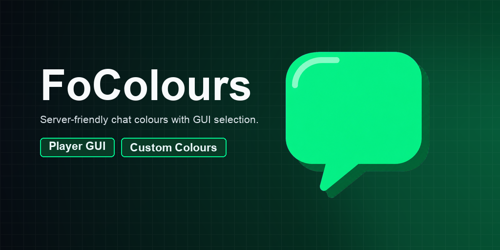
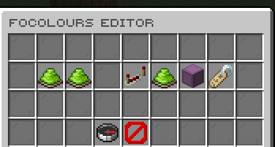
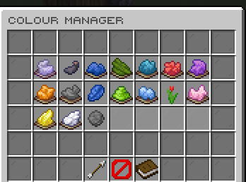
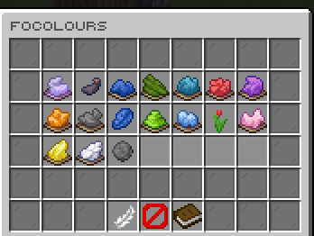

# FoColours

[](https://modrinth.com/plugin/focolours) [](https://modrinth.com/plugin/focolours/versions) [](https://discord.gg/kEF77QCfu7)

Configurable chat colours with player selection and administrator controls.

*Developed by Carrotio.*

## Features

- Gives players a GUI for selecting unlocked chat colours.
- Supports configurable solid colours, rainbow formatting, and a default colour.
- Lets administrators grant or remove colours and edit the available choices.
- Stores player selections and unlocks persistently.
- Includes optional PlaceholderAPI parsing and EzColors conversion controls.

## Download and dependencies

Download the latest compatible version from [Modrinth](https://modrinth.com/plugin/focolours). Check the [versions page](https://modrinth.com/plugin/focolours/versions) for supported Minecraft versions and server platforms.

- **Required:** None
- **Optional integrations:** `PlaceholderAPI`

## Screenshots



*Manage FoColours settings.*



*Edit the available chat colours.*



*Let players select an unlocked colour.*

## Support

For help or issue reports, join the [Carrotio Discord server](https://discord.gg/kEF77QCfu7).

<details>
<summary><strong>Commands and permissions</strong></summary>

### Commands

- `/focolours [reset|colour]` — Open the FoColours player menu or select a chat colour directly. Aliases: `/colours`, `/chatcolour`, `/chatcolor`.
- `/focoloursadmin <version|reload|editor|give|take|convertezcolors>` — Open the FoColours admin tools. Aliases: `/chatcolouradmin`.

### Permissions

- `focolours.use` — Allows using the FoColours player command. Default: `true`.
- `focolours.admin` — Allows using FoColours admin commands and editor features. Default: `op`.

</details>

<details>
<summary><strong>PlaceholderAPI</strong></summary>

When PlaceholderAPI is installed, `%focolours_colour%` supplies the player's
current chat colour format code. Rainbow has no single format code; use the
Java API's `renderText` method for a rainbow-aware integration.

</details>

<details>
<summary><strong>Configuration</strong></summary>

- `config.yml` — Main behavior and feature settings.
- `messages.yml` — Player-facing messages and interface text.
- `sounds.yml` — Configurable interaction sounds.
- `guis/*.yml` — GUI layouts, slots, labels, and lore.

Main config areas: `features`, `chat`, `native-dialogs`, `compatibility`, `player-data`, `rainbow`, `editor`, `gui`, `colours`.

</details>

<details>
<summary><strong>Developer API</strong></summary>

Compile against the matching jar (`provided` in Maven, `compileOnly` in Gradle); install it locally if needed. Declare `FoColours` in your plugin metadata (`softdepend` for an optional integration).

```xml
<dependency>
  <groupId>me.foesio</groupId>
  <artifactId>FoColours</artifactId>
  <version>1.8</version>
  <scope>provided</scope>
</dependency>
```

```java
import me.foesio.foColours.api.FoColoursApi;
import me.foesio.foColours.api.event.PlayerColourAccessChangedEvent;

FoColoursApi api = Bukkit.getServicesManager().load(FoColoursApi.class);
if (api != null) api.enabledColours();

@EventHandler
public void onPlayerColourAccessChangedEvent(PlayerColourAccessChangedEvent event) {
    Bukkit.getLogger().info(event.getClass().getSimpleName());
}
```

**API methods** (overloads grouped):

- `FoColoursApi`: `enabledColours`, `findEnabledColour`, `playerColours`, `grantColour`, `takeColour`, `selectColour`, `resetColour`, `renderText`.

**Other API types:** `ColourChangeCause`, `ColourChangeResult`, `ColourSnapshot`, `ColourType`, `PlayerColourSnapshot`.

**Events:** `PlayerColourAccessChangedEvent`, `PlayerColourSelectionChangedEvent`.

[Browse API source](src/main/java/me/foesio/foColours/api) for signatures and event details.

</details>
